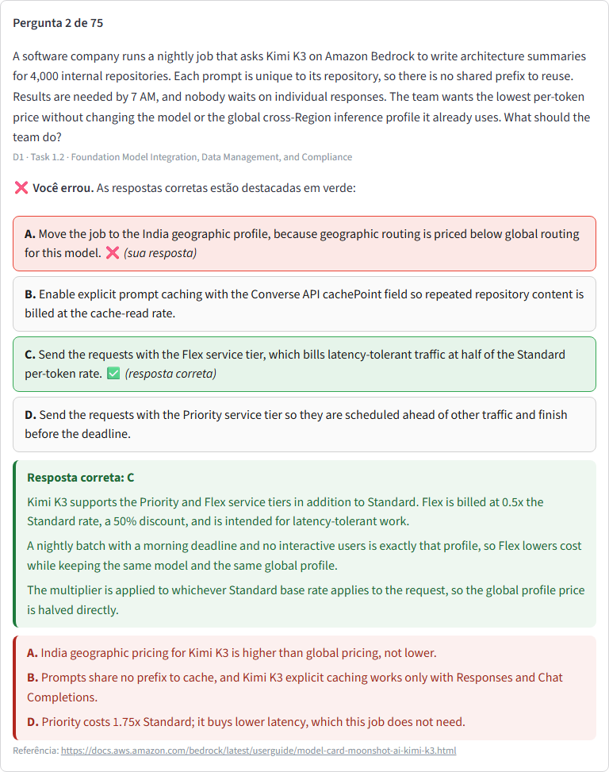

Obs.: caso o app esteja no modo "sleeping" (dormindo) ao entrar, basta clicar no botão que estará disponível e aguardar, para ativar o mesmo.



# AWS Simulator (AIP-C01)

Um web app de simulado para a certificação **AWS Certified Generative AI Developer – Professional (AIP-C01)**, edição 2026, construído com Python e Streamlit.
As perguntas vêm de um CSV hospedado no Google Drive (com fallback para o CSV local). O cronômetro fica fixo no canto superior direito, e cada resposta é corrigida na hora, com explicação.

## O exame real (guia oficial da AWS)

| | |
|---|---|
| Perguntas | 75 (65 pontuadas + 10 não pontuadas), escolha única ou múltipla |
| Duração | 180 minutos (+30 minutos de acomodação ESL para quem não é nativo em inglês) |
| Aprovação | 750, numa escala de 100 a 1.000 |
| Idiomas | inglês, japonês, coreano e chinês simplificado |

Domínios e pesos: **1.** Foundation Model Integration, Data Management, and Compliance (31%) · **2.** Implementation and Integration (26%) · **3.** AI Safety, Security, and Governance (20%) · **4.** Operational Efficiency and Optimization for GenAI Applications (12%) · **5.** Testing, Validation, and Troubleshooting (11%).

## Funcionalidades

- 75 perguntas inéditas em inglês, no estilo do exame (cenários com "MOST cost-effective", "LEAST operational overhead"), atualizadas com a documentação da AWS de setembro e outubro de 2026. Elas cobrem os **domínios 1, 2 e 3** (30, 25 e 20 perguntas), na proporção dos pesos oficiais.
- Perguntas de escolha única e de múltipla escolha com **2 ou 3 respostas** ("Select TWO" / "Select THREE"). Na múltipla, o botão de confirmar só libera com a quantidade exata marcada, e só vale ponto quem acerta todas.
- Ao responder, aparece logo abaixo a **resposta correta com a explicação, em verde**, e **uma linha com o motivo de cada alternativa incorreta, em vermelho**, além do link da documentação oficial.
- Três modos: 180 minutos (como no exame real), 210 minutos (com a acomodação ESL) ou sem limite de tempo.
- Timer atualizado a cada segundo, fixo no canto superior direito.
- Som de fundo em loop, que começa ao clicar em "Iniciar Simulado" e para quando o simulado termina (ou ao recarregar a página com F5).
- Barra de progresso, nota final em percentual e **desempenho por domínio**.
- Encerramento automático ao responder tudo ou ao esgotar o tempo.
- Visual limpo e focado, com os elementos padrão do Streamlit ocultos via CSS. Uso sugerido em computador.

## Desempenho e robustez

- O banco de perguntas é validado ao carregar e fica **num único objeto compartilhado em memória** (`st.cache_resource`, TTL de 24 horas, o mesmo do som). Assim, não há cópia por usuário nem desserialização a cada clique.
- Cada sessão **congela o banco no início da prova**: se o cache do Drive renovar no meio, a prova em andamento não muda.
- Download do Drive com sessão HTTP reaproveitada, **retry com backoff exponencial e jitter**, recusa da página HTML de aviso do Drive, **fallback** para o CSV local e um disjuntor que evita insistir no Drive por 5 minutos depois de uma falha.
- Respostas guardadas como índices (estado de sessão compacto). Os callbacks são **idempotentes**: clique duplo não altera a resposta travada. O timer roda num fragmento, sem recarregar a página inteira.
- O som de fundo (`static/som.mp3`, afinação 432 Hz) vai **íntegro, sem recompressão**: o base64 do arquivo inteiro fica em cache na memória, junto com o banco de questões, e entra num `<audio autoplay loop>`. Como esse HTML não muda entre um clique e outro, o Streamlit envia o som uma única vez por sessão, e o navegador mantém a música tocando sem reiniciar.

## Pré-requisitos

- Python 3.13 (no Streamlit Community Cloud, escolha **Python 3.13** em *Advanced settings* na hora do deploy)
- (Opcional) Conta Google Drive para hospedar o CSV de perguntas
- (Opcional) Variável de ambiente `GOOGLE_DRIVE_CSV_URL` com o link direto do CSV

## Instalação

1. Clone este repositório:

```
git clone https://github.com/aryribeiro/aws-simulator5.git
cd aws-simulator5
```

2. (Opcional) Crie e ative um ambiente virtual:

```
python -m venv .venv
source .venv/bin/activate      # Linux/macOS
.venv\Scripts\activate         # Windows
```

3. Instale as dependências:

```
pip install -r requirements.txt
```

4. (Opcional) Crie um arquivo `.env` com a variável abaixo. No Streamlit Community Cloud, coloque a mesma linha em *Settings → Secrets*:

```
GOOGLE_DRIVE_CSV_URL="https://drive.google.com/uc?export=download&id=SEU_ID_DO_ARQUIVO"
```

O arquivo no Drive precisa estar compartilhado como "Qualquer pessoa com o link". Sem a variável (ou se o Drive estiver indisponível), o app usa o `questions.csv` da pasta do projeto.

## Como usar

Execute o app com o comando abaixo e acesse no navegador:

```
streamlit run app.py
```

O banco de questões fica em `questions.csv`. As listas são gravadas como JSON:

| Coluna | Conteúdo |
|---|---|
| `question` | enunciado |
| `options` | alternativas, na ordem A, B, C… |
| `answer` | texto da(s) alternativa(s) correta(s) |
| `multiple` | `True` para múltipla escolha (2 ou 3 corretas) |
| `explanation` | parágrafos da explicação da correta (verde) — opcional |
| `wrong` | objeto `{"texto da alternativa incorreta": "motivo"}` (vermelho) — opcional |
| `reference` | URL(s) da documentação — opcional |
| `domain` | domínio e task do guia, ex.: `D1 · Task 1.2 · ...` — opcional |

As colunas opcionais podem ficar vazias, e um CSV antigo, só com as 4 primeiras colunas, continua funcionando. O `manage_questions.py` é um app auxiliar para adicionar e remover perguntas com validação:

```
streamlit run manage_questions.py
```

Depois de editar o banco, faça upload do CSV para o Google Drive (ou use o CSV local) e rode o web app em ambiente local ou em produção. Obs.: o CSV do Drive é cacheado por 24 horas (para aplicar um CSV novo antes disso, use *Reboot app* no painel do Streamlit); recarregue (F5) para reiniciar o simulado.

Material não oficial, criado para estudo a partir do guia oficial do exame e da documentação da AWS.

## Autor

- Ary Ribeiro
- LinkedIn: https://www.linkedin.com/in/aryribeiro
- Contato: aryribeiro@gmail.com
